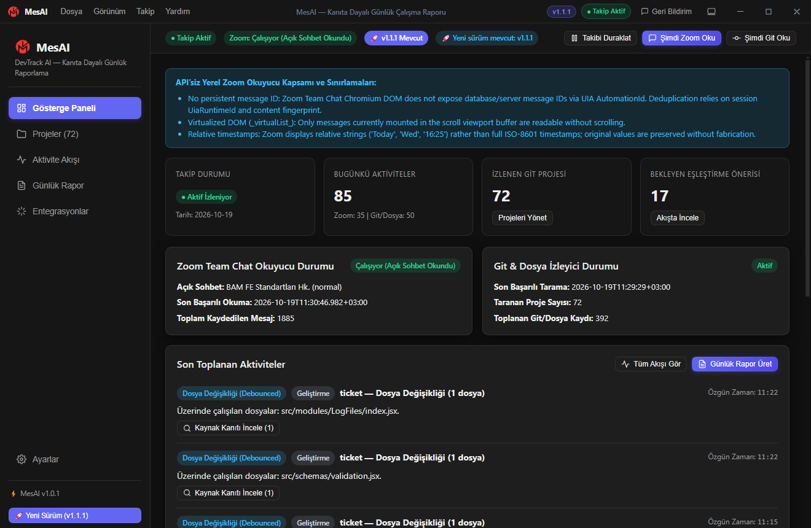
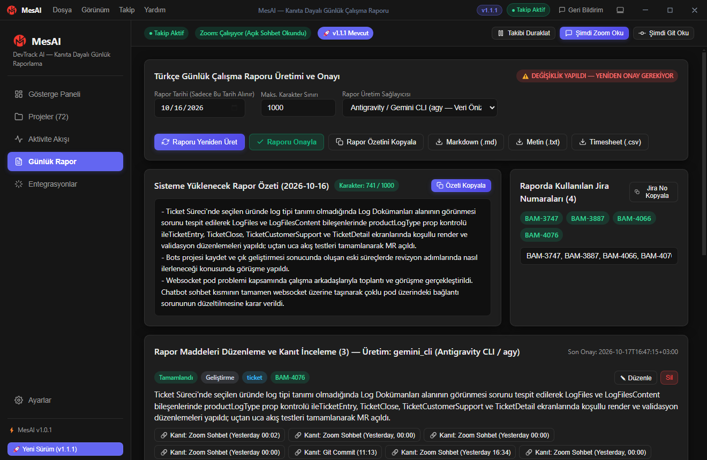
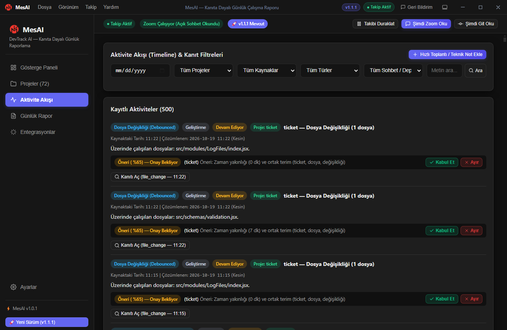
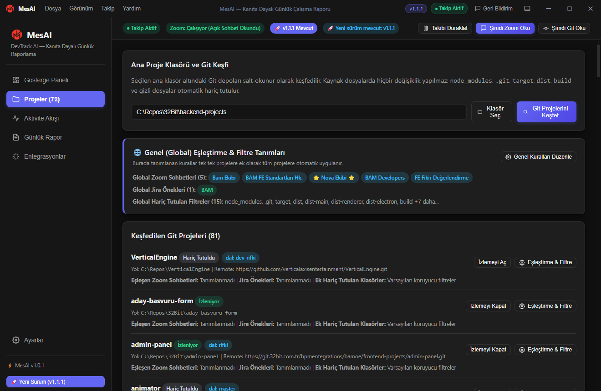
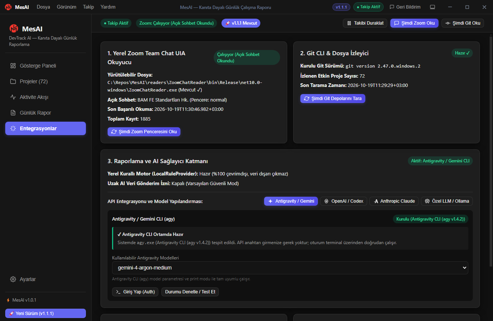
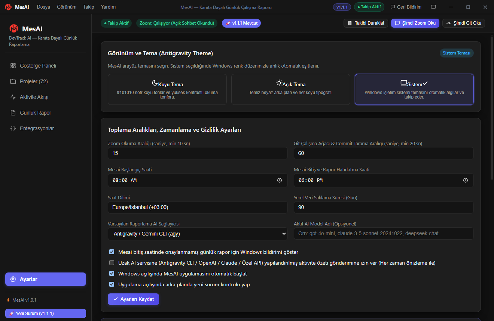
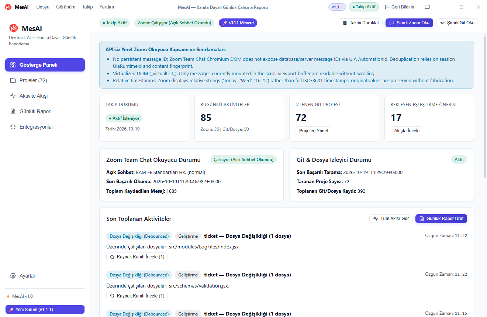

<div align="center">


# MesAI (DevTrack AI)
### Kanıta Dayalı Günlük Çalışma Raporu ve Geliştirici Aktivite Takip Uygulaması

[](https://www.electronjs.org/)
[](https://react.dev/)
[](https://www.typescriptlang.org/)
[](https://vitejs.dev/)
[](https://dotnet.microsoft.com/)
[](https://www.sqlite.org/)
[](https://www.microsoft.com/windows)

<p align="center">
  <b>MesAI</b>, gün içindeki yazılım geliştirme faaliyetlerini (Git commitleri, çalışma ağacı, debounced dosya değişiklikleri) ve teknik görüşmeleri (yerel Windows UI Automation tabanlı Zoom Team Chat okuyucusu ve hızlı notlar) toplayarak <b>kanıta dayalı Türkçe günlük çalışma raporu</b> üreten modern bir masaüstü uygulamasıdır.
</p>

</div>

---

## 📸 Uygulama Arayüzü ve Ekran Görüntüleri

### 1. Gösterge Paneli (Dashboard)
Günün canlı çalışma özeti, Zoom ve Git izleyici durumları, son aktiviteler ve eşleştirme bekleyen kayıtlar tek ekranda izlenir.

<div align="center">
  
</div>

---

### 2. Türkçe Günlük Çalışma Raporu Üretimi
Toplanan tüm kanıtlar analiz edilerek karakter sınırına uygun, Jira numaraları otomatik ayrıştırılmış ve projeler bazında gruplanmış günlük çalışma raporu üretilir. Üretilen rapor düzenlenebilir, tek tıkla kopyalanabilir veya Markdown/Timesheet olarak dışa aktarılabilir.

<div align="center">
  
</div>

---

### 3. Aktivite Akışı (Timeline) ve Kanıt İnceleme
Gün boyunca kaydedilen tüm dosya hareketleri, commit'ler ve Zoom yazışmaları zaman çizelgesinde listelenir. Akıllı eşleştirme algoritması aktiviteleri projelere önerir; kullanıcı tek tıkla kabul edebilir veya ayırabilir.

<div align="center">
  
</div>

---

### 4. Proje Yönetimi ve Git Depo Keşfi
Ana çalışma dizini seçildiğinde tüm Git depoları otomatik taranır. Projeler için özel Zoom sohbet eşleştirmeleri, Jira önekleri ve global hariç tutma filtreleri tanımlanabilir.

<div align="center">
  
</div>

---

### 5. Entegrasyonlar ve AI Sağlayıcı Katmanı
API anahtarı gerektirmeyen yerel CLI araçları (Antigravity / Gemini CLI `agy`, OpenAI Codex, Claude Code, Ollama) otomatik tespit edilir, kurulur ve test edilir. Jira ve Jenkins entegrasyon şifreleri Windows DPAPI ile korunur.

<div align="center">
  
</div>

---

### 6. Ayarlar ve Tema Tercihleri (Dark / Light Mode)
Antigravity Theme Engine ile koyu (dark), açık (light) ve Windows işletim sistemiyle senkron çalışan tema modları sunulur. Raporlama saatleri ve arka plan toplama aralıkları özelleştirilebilir.

<div align="center">
  
  
</div>

---

## 🌟 Öne Çıkan Özellikler

- 🛡️ **API'siz Salt-Okunur Zoom Team Chat Okuyucusu:**
  - Zoom API veya yönetici izni gerektirmez.
  - Windows UI Automation (`UIAutomationClient`) üzerinden Zoom Workplace uygulamasındaki açık sohbeti arka planda okur.
  - Odak çalmaz, otomatik tıklama yapmaz, Zoom içi okundu işaretlemesi yapmaz.
  - Göreli saatleri (`Today`, `Wed`, `16:25`) yerel saat dilimine göre çözümler.
  - Aynı dakikada gelen ardışık mesajları ve tekrarlı taramaları parmak iziyle tekilleştirir.
- 🔍 **Kanıta Dayalı (Evidence-Based) Doğrulama:**
  - Rapora giren her bir madde somut bir dosya değişikliği, Git commit'i, Zoom mesajı veya manuel nota bağlanır.
  - Uydurma veya doğrulanmamış içerik oluşturulmaz.
- 🧠 **Çift Katmanlı Rapor Motoru:**
  - **Yerel Kural Motoru (`LocalRuleProvider`):** %100 yerel, çevrimdışı, deterministik kurallarla çalışan sıfır veri sızıntılı Türkçe rapor üreticisi.
  - **Gelişmiş CLI Adaptörleri (`GeminiCliProvider`, `OpenAI`, `Claude`, `Ollama`):** Terminal oturumu üzerinden çalışan, prompt injection korumalı (`<untrusted_evidence_json>`) ve gönderim öncesi kullanıcı onay modalı sunan yapı.
- 🔐 **Donanım Destekli Güvenli Kimlik Saklama:**
  - Jira ve Jenkins entegrasyonlarında parolalar/token'lar asla düz metin olarak kaydedilmez.
  - Windows DPAPI (`electron.safeStorage`) ile şifrelenir.
- ⚡ **Yüksek Performanslı Altyapı:**
  - SQLite WAL modunda `node:sqlite` (`DatabaseSync`) ile mikro-saniyeler seviyesinde yerel veri erişimi.
  - React 19 sanallaştırılmış liste (`VirtualList`) ile binlerce aktivite ve projede pürüzsüz 60 FPS kaydırma.
- 🚀 **Otomatik Güncelleme ve Görev Çubuğu:**
  - GitHub Releases üzerinden otomatik versiyon kontrolü ve sessiz güncelleme.
  - Windows görev çubuğu küçük resim araç çubuğu (Thumbar: Başlat/Durdur/Senkronize Et) ve sistem tepsisi (Tray) kontrolleri.

---

## 🏗️ Mimari ve Teknoloji Yığını

| Katman | Teknoloji | Açıklama |
|---|---|---|
| **Masaüstü Kabuğu** | Electron 35 | Güvenli süreç izolasyonu (`contextIsolation: true`, `nodeIntegration: false`, preload köprüsü) |
| **Kullanıcı Arayüzü** | React 19 + TypeScript + Vite 6 | Antigravity tasarım sistemi, CSS Değişkenleri ile Light/Dark tema, Lucide tabanlı yerel SVG ikonlar |
| **Yerel Veritabanı** | Node.js `node:sqlite` | WAL (Write-Ahead Logging) modu, otomatik şema migrasyonları, ilişkisel kanıt tablosu |
| **Zoom UIA Servisi** | C# / .NET 10 (`net10.0-windows`) | Windows UI Automation tabanlı salt-okunur yardımcı CLI süreci (`readers/ZoomChatReader`) |
| **Git & Dosya İzleyici** | Node.js `fs.watch` + Git CLI | 400ms debounced dosya takip motoru ve periyodik Git commit/diff çözümleyicisi |
| **Şifreleme** | Windows DPAPI | `electron.safeStorage` ile kullanıcı bazlı anahtar şifreleme |
| **Paketleme & Dağıtım**| `electron-builder` | Portable `.exe` ve kurulumsuz Windows paketleri |

---

## 📌 Yerel Zoom Okuyucu (`ZoomChatReader`) Kapsamı ve Sınırlamaları

Zoom API veya geliştirici uygulaması yetkisi bulunmadığından, Zoom verisi yalnızca yerel `ZoomChatReader.exe` yardımcı süreci üzerinden **salt-okunur** olarak toplanır:

1. **Pencere ve Görünüm Kapsamı:**
   - Yalnızca o an Zoom Workplace (`ZPPTMainFrmWndClassEx` -> `Chrome_RenderWidgetHostHWND`) içinde açık olan sohbeti (`_chatPanel_`) ve sanal listede (`_virtualList_`) yüklü DOM tamponundaki mesajları okur.
   - Pencere simge durumuna küçültülmüş (`minimized`) olsa dahi pencereyi öne getirmeden arka planda okuyabilir.
   - Yan etki (okundu işaretleme, odak çalma) oluşturmamak için otomatik kaydırma (scroll) veya başka sohbetlere tıklama **yapmaz**.
2. **Durum Ayrıştırması:**
   - Okuyucu her çalışmada `status` alanı üretir: `ok`, `zoom_not_running`, `window_minimized_or_hidden`, `chat_panel_not_open`, `timeout` veya `error`.
3. **Tekilleştirme (Deduplication):**
   - Zoom UIA ağacı sunucu/veritabanı mesaj ID'si (`persistentMessageId: null`) sunmaz.
   - Tekilleştirme `sessionId/chatName + çözümlenen tarih + görünen saat + gönderen + içerik özeti (SHA-256) + görünüm içi sıra numarası (occurrenceIndexInView)` ile yapılır. Tekrarlanan okumalar kopya oluşturmaz; aynı kişinin aynı dakikada gönderdiği ikinci aynı metin ise `occurrenceIndexInView` ile korunur.
4. **Göreli Tarih Çözümleme:**
   - `Today`, `Yesterday`, `Wed`, `16:25` gibi ifadeler gözlem zamanı ve yerel saat dilimi (`+03:00`) ile çözümlenir; özgün tarih ifadesi (`rawTimestampText`) her zaman korunur.

---

## 💻 Sistem Gereksinimleri

- **İşletim Sistemi:** Windows 10 / Windows 11 (x64)
- **Node.js:** `v22.5.0+` veya `v24.x` (`node:sqlite` yerleşik desteği için zorunludur)
- **.NET SDK / Runtime:** `.NET 10.0 Windows Desktop Runtime` (`ZoomChatReader.exe` için)
- **Git:** `git` komutunun `PATH` üzerinde erişilebilir olması

---

## 🚀 Geliştirme ve Kurulum

```powershell
# 1. Depoyu klonla
git clone https://github.com/rifkikesepara/MesAI.git
cd MesAI

# 2. Bağımlılıkları yükle
npm install

# 3. Yalnızca C# ZoomChatReader okuyucusunu derle (Release)
npm run build:reader

# 4. Tüm projeyi derle (ZoomChatReader + Electron Main + React Renderer)
npm run build

# 5. Birim ve entegrasyon testlerini çalıştır
npm test

# 6. Geliştirme modunda başlat
npm start
```

---

## 📦 Paketleme ve Test Komutları

```powershell
# Gerçek ortam duman testi (Zoom + Git okuma + Rapor üretimi + JSON doğrulama)
npx electron . --verify-smoke

# Arayüz doğrulama testi (UI render, başlıklar, skeleton ve bileşen kontrolü)
npx electron . --verify-ui

# Ekran görüntülerini otomatik yakala ve docs/images dizinine kaydet
npx electron . --capture-screenshots

# Paketlenmiş Windows uygulama dizini oluştur (dist-electron/win-unpacked)
npm run pack:dir

# Bağımsız Windows Portable (.exe) paketi üret (dist-electron/MesAI-1.0.1-Portable.exe)
npm run pack:win
```

### Okuyucunun Paketlenmesi (`extraResources`)
`electron-builder.yml` yapılandırması, `readers/ZoomChatReader/bin/Release/net10.0-windows` altındaki derlenmiş `ZoomChatReader.exe` ve bağımlılıklarını paketlenmiş uygulamanın `resources/ZoomChatReader/` dizinine kopyalar. `ZoomReaderAdapter` çalışma zamanında önce `process.resourcesPath/ZoomChatReader/ZoomChatReader.exe` yolunu, geliştirme modunda ise `readers/ZoomChatReader/bin/Release/net10.0-windows/ZoomChatReader.exe` yolunu otomatik kullanır.

---

## 📄 Lisans

Bu proje özel geliştirici mülkiyetindedir. Tüm hakları saklıdır.
